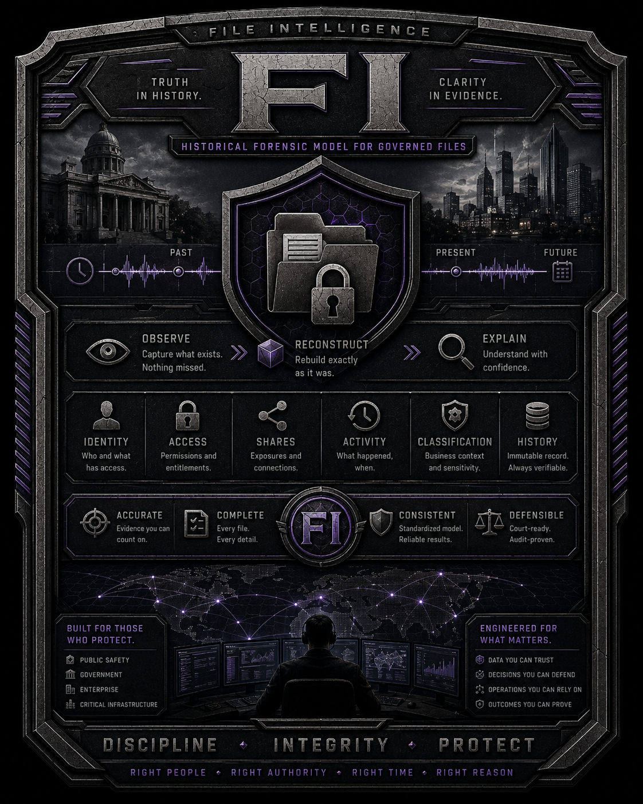

  

# File Intelligence

**Understand the file. Know its history. Trust the evidence.**

File Intelligence (FI) is an on-premises, file-centered intelligence platform being developed by **Iron Signal Systems**. Its purpose is to help IT professionals understand the files they are responsible for: what a file is, where it has been, what changed, who could access it, and what the available evidence actually establishes.

## Our mission

**Turn fragmented information about files into lasting, understandable, and trustworthy knowledge.**

A question about one file can lead an administrator through NTFS metadata, permissions, SMB shares, Active Directory, Windows Security events, the USN journal, and years of incomplete records. Those sources tell different parts of the story. Reconstructing that story again and again takes time, expertise, and often more evidence than is still available.

FI is being built to preserve the relevant source facts as they are observed, establish their relationships over time, and make that history useful to the people who support, secure, and manage an organization.

**The file is the subject. Events, identities, permissions, and changes are part of its history.**

## The questions FI exists to answer

- **What happened to this file?** Where was it, was it renamed or moved, and how did its state change?
- **Who could access it, and why?** What permissions, shares, and identity relationships contributed to that access?
- **What activity was actually observed?** Which changes or interactions can be supported by captured evidence?
- **What did we know at a particular point in time?** What was established then, and what information is missing?
- **What might be affected?** Which governed files share an exposure, access relationship, or relevant historical connection?

FI's goal is to make difficult file-related investigations understandable without requiring every user to manually correlate raw logs, file-system structures, and database records.

## How we approach that mission

**Files, not just paths.** A pathname can change. FI follows the identity and relationships of governed file-system objects so their history is not reduced to a sequence of names.

**Evidence before conclusions.** FI distinguishes what was **Observed**, **Derived**, **Classified**, **Unknown**, or **Incomplete**. An absence of evidence is not evidence that nothing happened. Historical gaps must remain visible.

**Intelligence, not automatic remediation.** FI is intended to observe, preserve, correlate, and explain. It does not automatically change customer files, permissions, identities, shares, or infrastructure. Administrators remain in control of decisions and actions. Installation may require separately approved configuration and auditing prerequisites.

**On-premises and customer-controlled.** FI is designed for organizations that want to keep their file intelligence and historical records within infrastructure they control.

**One system, straightforward to operate.** The finished product is intended to provide an integrated, configuration-driven installation and management experience. Internal services, verification, storage, and processing should not become a collection of components the customer must assemble by hand.

**Built for practical IT work.** File intelligence should be useful to service desks, system administrators, security teams, auditors, and investigators—not only to specialists who understand the underlying collection mechanisms.

## Development status

FI is **pre-alpha and under active development**. Its collection, signed transport, and historical recording foundations are being engineered and validated; classification, published projections, queries, and the user experience remain part of the ongoing product work.

The current development scope centers on Windows/NTFS and Active Directory sources with an on-premises FreeBSD/PostgreSQL backend. The target for an initial pilot is **August 2028–2029**, subject to completing the required acceptance testing.

FI is **not yet a released or production-ready product**. This README describes the mission and intended capabilities, not a claim that every capability is currently delivered.

## Project documentation

The [documentation index](docs/README.md) contains the current engineering references, operational contracts, acceptance records, and historical technical notes moved out of the former long README.

## Licensing and security

FI is **proprietary, source-available software**, not an open-source project. It is developed by **John Joseph Wood** under the **Iron Signal Systems** project and brand name. See [LICENSE](LICENSE) for applicable rights and restrictions and [SECURITY.md](SECURITY.md) for responsible vulnerability reporting.
