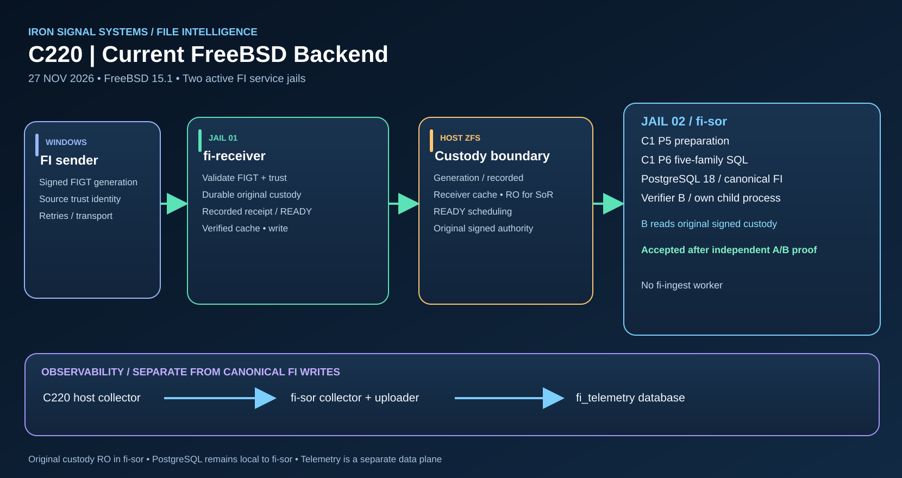
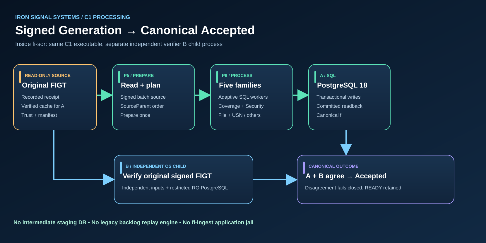

# FI C220 — current backend architecture

**Observed:** 2026-11-27, `c220`, FreeBSD 15.1-RELEASE-p5. This is the **current running backend**, not a historical phase proposal.



## Current execution path

```text
Windows sender (signed FIGT)
  -> fi-receiver jail (validate, durable custody, receipt, READY, verified cache)
  -> receiver-owned ZFS signed custody + verified cache
  -> fi-sor jail: C1 P5 preparation -> P6 five families -> PostgreSQL 18
        + independent verifier B process checks ORIGINAL signed FIGT and read-only SQL
  -> canonical Accepted only after A/B proof, then governed READY retirement
```

**Only `fi-receiver` and `fi-sor` are active FI ingest/service jails.** `fi-dev` is a build/development jail. Old `fi-ingest` mounts/datasets persist on disk but do not constitute a running ingest worker. An old shared `fi-c1-handoff` tmpfs mount also persists, but it is not a processing hop in the single-jail C1 executable.

## Runtime components

| Location | Current binary | Source | Function |
|---|---|---|---|
| `fi-receiver` jail | `/usr/local/sbin/fi-receiver` | `go/cmd/fi-receiver` | Sender trust, signed FIGT custody, durable recorded receipts, receiver-owned verified cache |
| `fi-sor` jail | `/usr/local/sbin/fi-c1-sor-live` | `go/cmd/fi-c1-sor-local` with `fi_c1_sor_dev` tag | P5 Preparation, P6 Family Processing, continuous READY intake, independent B child |
| `fi-sor` jail | `/usr/local/bin/postgres` | FreeBSD PostgreSQL 18 package | Canonical FI SoR |
| C220 host + `fi-sor` | `/usr/local/sbin/fi-telemetry-backend` | `go/cmd/fi-telemetry-backend` | Separate collection and upload to `fi_telemetry` |



## Custody, access and acceptance

| Authority | `fi-receiver` | `fi-sor` |
|---|---|---|
| Original generation custody and receipts | RW | RO |
| Receiver-authenticated verified cache | RW | RO |
| READY queue | RW | RW, governed retirement only |
| PostgreSQL `fi` SoR data | No mounted access | Local DB-owned RW |
| Trust and registered source configuration | Controlled RO source | Controlled RO view |

P5/P6 prepares the source and writes to the local canonical PostgreSQL database. B is not a permanently running service: `fi-c1-sor-live` spawns an independent child with `--c1-b-child`, using original signed material, not the receiver cache alone. A-side SQL commit is not by itself the final canonical acceptance decision.

Normal C1 launcher uses 5-second READY polling, max 32 adaptive SQL workers, and local PostgreSQL sockets; see `tools/deployment/freebsd/runtime.d/fi-c1-sor-live-run.sh`. The old inter-jail worker and clone/backlog benchmarks are **not** the current runtime.

## Telemetry plane

A 15-second collector runs on the C220 host; telemetry collectors/uploader were observed running in `fi-sor`. The checked-in design uses separate durable spool entries and a five-minute uploader to `fi_telemetry.telemetry_v2`. The process inventory confirms running processes but not fresh cadence/delivery acceptance. Telemetry does not write canonical `fi`.

## Observed evidence and limitations

- Live C220 receiver: SHA-256 `c0006e7de05c38eb4da4869de5c9b8ecb56663b4ea35ed44b7a248ca23375f8c`.
- Live C220 C1: SHA-256 `54ea5cce0538ba0f65cd1d6effc78b695ed44bd2f8257aa14781bf1e58e558b2`.
- Live telemetry: SHA-256 `dab1deb8cc39ded4c9b293e74bc8c39f30a61393828dc73899a8db560ccf3a11`.
- Operator-observed canonical SoR results: 53 accepted generations, 631 committed records (historical queued generations on 2026-11-27).
- FreeBSD cross-build and disposable native PostgreSQL 18 CI passed for the candidate source. Binary identity with live C220 and fresh-install DR are **not yet proven**.
- No configuration, data, service or secret was modified on C220 during the repository cleanup.

For ZFS dataset names, RO/RW mount evidence, process inventory and recorded binary hashes, see [C220 as-built](../deployment/C220-FREEBSD-AS-BUILT-20261127.md). For service details, see [FreeBSD runtime](../../tools/deployment/freebsd/README.md).
