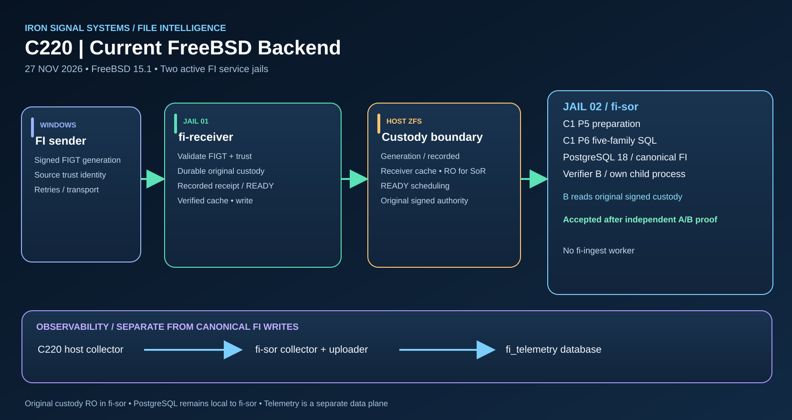

# FI C220 — operational reference

**Current backend:** `fi-receiver` and `fi-sor` on FreeBSD 15.1, with host and SoR telemetry. Historical `fi-ingest`/`fi-sor-db` topology and Linux ingest-worker service documentation are **not** current C220 instructions.



## Running services

| Jail | Executable | Installed service |
|---|---|---|
| `fi-receiver` | `/usr/local/sbin/fi-receiver` | `fi_receiver` |
| `fi-sor` | `/usr/local/sbin/fi-c1-sor-live` | `fi_c1_sor_live` |
| `fi-sor` | `/usr/local/bin/postgres` | `postgresql` |
| Host + `fi-sor` | `/usr/local/sbin/fi-telemetry-backend` | `fi_telemetry_sample`; SoR upload service `fi_telemetry_upload` |

## Read-only inventory

Run from physical C220 only:

```sh
hostname; uname -sr; jls
jexec fi-receiver ps -axww -o pid,user,command
jexec fi-sor ps -axww -o pid,user,command
sha256 -q /fast/jails/roots/fi-receiver/usr/local/sbin/fi-receiver
sha256 -q /fast/jails/roots/fi-sor/usr/local/sbin/fi-c1-sor-live
sha256 -q /usr/local/sbin/fi-telemetry-backend
mount -p | grep -E 'fi-c220-20261114|fi/sor/pgdata|fi/telemetry/spool'
```

Compare to the [operator-observed as-built](C220-FREEBSD-AS-BUILT-20261127.md). No data deletion, service restart or SQL write is authorized by this guide.

## Operational source and safety

The active runtime source is `go/cmd/fi-receiver`, `go/cmd/fi-c1-sor-local` (built with `fi_c1_sor_dev` tag), `go/cmd/fi-telemetry-backend`, and shared `go/internal/` packages. Active service scripts are in `tools/deployment/freebsd/runtime.d/`.

Historical `fi-bootstrap.sh`/three-jail host templates are legacy and **must not be used against C220**. The observed live binary hashes are not yet reproducibly matched to the source output. No complete fresh-install procedure has been independently accepted.

[Current architecture and A/B detail](../architecture/FI-C220-CURRENT-BACKEND.md).
