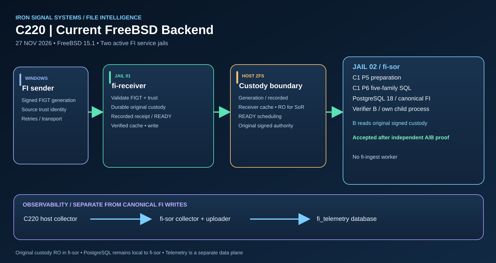

# FI C220 — running jail and storage layout

> **Observed 27 Nov 2026:** This describes the currently running C220 FreeBSD 15.1 backend, not a future three-jail design or a verified fresh-install recipe. [Current architecture and diagrams](../../../docs/architecture/FI-C220-CURRENT-BACKEND.md).

The two active FI service jails are **fi-receiver** and **fi-sor**. The fi-dev jail is for development; old fi-ingest and fi-frontend datasets/jails are not in the current ingest path.

| Item | Observed host path | Mount/role |
|---|---|---|
| Receiver jail root | `/fast/jails/roots/fi-receiver` | Running receiver process |
| SoR jail root | `/fast/jails/roots/fi-sor` | Running C1 P5/P6, verifier B child, PostgreSQL 18 |
| Dev jail | `/fast/jails/roots/fi-dev` | No ingest processing |
| Original custody | `/work/fi-c220-20261114/custody/generation` | Receiver RW, SoR RO |
| Recorded receipts | `/work/fi-c220-20261114/custody/recorded` | Receiver RW, SoR RO |
| Verified cache | `/work/fi-c220-20261114/custody/verified-cache` | Receiver RW, SoR RO |
| READY | `/work/fi-c220-20261114/custody/ready` | Receiver RW, SoR RW (governed retirement) |
| PostgreSQL PGDATA | `/fast/data/fi/sor/pgdata` | SoR `/var/db/fi/sor/postgres` RW |
| PostgreSQL WAL dataset | `/fast/data/fi/sor/pgwal` | Host-managed ZFS |
| Telemetry spool | `/fast/data/fi/telemetry/spool` | SoR RW |

The retained `/var/run/fi-c1-handoff` tmpfs mount is **not evidence of an active inter-jail handoff**. The current `fi-c1-sor-live` is a single-jail executable.

Current `ifconfig`, PF rules and detailed VNET addresses were **not included in the process/mount inventory**. Do not invent them or use old `10.77.x`/`vtnet` addresses. See the [as-built](../../../docs/deployment/C220-FREEBSD-AS-BUILT-20261127.md).
