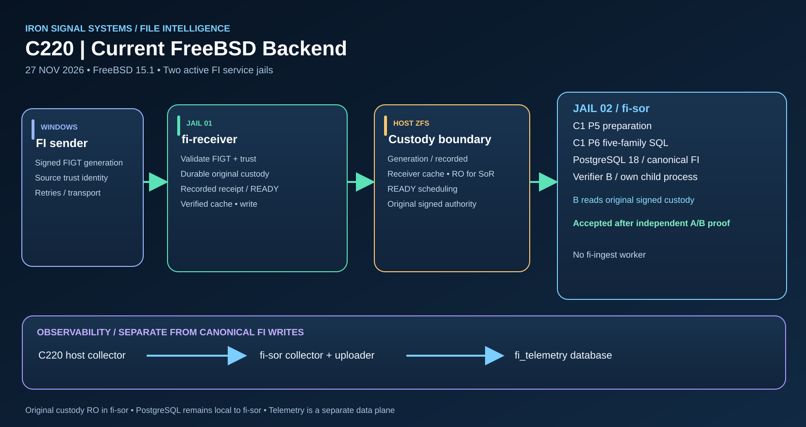

# FI C220 — current jail capabilities

> **Observed 27 Nov 2026:** This describes the currently running C220 FreeBSD 15.1 backend, not a future three-jail design or a verified fresh-install recipe. [Current architecture and diagrams](../../../docs/architecture/FI-C220-CURRENT-BACKEND.md).

Live FI operation is separated across two service jails; PostgreSQL and the C1 processing engine reside together inside fi-sor. There is no live fi-ingest application worker or fi-sor-db jail.

| Scope | Allowed authority | Explicitly excluded |
|---|---|---|
| `fi-receiver` | TLS transport; source trust validation; signed generation custody, receipts, verified cache and READY publication | Canonical SoR PostgreSQL writes |
| `fi-sor` C1 A | Read signed custody and verified cache; process READY; controlled canonical SQL writes | Rewrite original signed receipts/FIGT |
| `fi-sor` independent B child | Independently verify original signed custody; restricted read-only PostgreSQL checks | SQL mutation or reliance on A/cache as the sole proof |
| `fi-sor` PostgreSQL | Local canonical data storage | Direct ungated external SQL exposure |
| Host/SoR telemetry | Collect metadata and write a separate `fi_telemetry` plane | Canonical FI mutation |

Privileged interface, routing, PF, jail, ZFS, fstab, snapshot and service identity changes remain physical-host administrator actions. No jail should be granted extra mount/ZFS administration rights merely for convenience.

**Verification limit:** the provided mount inventory proves specific RO/RW nullfs boundaries; it did **not** include every jail capability flag or network rule.
