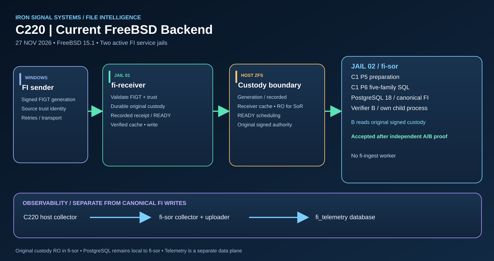

# FI C220 FreeBSD backend — current deployment source

**Current C220 runtime observed 2026-11-27:** `fi-receiver` + `fi-sor` jails, PostgreSQL 18 in `fi-sor`, telemetry collector on host and telemetry collector/uploader in `fi-sor`.



[Current architectural contract and independent verifier B](../../../docs/architecture/FI-C220-CURRENT-BACKEND.md) · [Observed C220 binaries/mounts](../../../docs/deployment/C220-FREEBSD-AS-BUILT-20261127.md) · [Read-only operator reference](../../../docs/deployment/C220-OPERATOR-REFERENCE.md)

## Current compilation from GitHub

From the checked-out `go` module directory:

```sh
GOOS=freebsd GOARCH=amd64 CGO_ENABLED=0 go build -trimpath -o fi-receiver ./cmd/fi-receiver
GOOS=freebsd GOARCH=amd64 CGO_ENABLED=0 go build -trimpath -tags fi_c1_sor_dev -o fi-c1-sor-live ./cmd/fi-c1-sor-local
GOOS=freebsd GOARCH=amd64 CGO_ENABLED=0 go build -trimpath -o fi-telemetry-backend ./cmd/fi-telemetry-backend
```

These commands passed CI; they do **not** establish byte-for-byte identity with the binaries already running on C220.

## Current FreeBSD runtime files

- `runtime.d/fi-receiver.rc.d` and `runtime.d/fi-receiver-supervisor.sh` — receiver service; generation/recorded/READY/verified-cache paths are sourced from restricted jail-local configuration.
- `runtime.d/fi-c1-sor-live.rc.d` and `runtime.d/fi-c1-sor-live-run.sh` — `fi-sor`-local C1 P5/P6/independent B; default 5-second poll, 16 READY slots, max 32 SQL workers.
- `runtime.d/fi-telemetry-sample.rc.d`, `runtime.d/fi-telemetry-upload.rc.d` — telemetry samples and recording.
- `runtime.d/fi-telemetry-v2-schema.sql`, `fi-telemetry-v2-roles.sql` — telemetry-only SQL schema and identities, never canonical `fi` by mistake.
- `operations/` — C220-specific audit/staging helpers and disposable VM native PostgreSQL gate, extracted from the retired backlog CLI.

**Not current runtime:** `go/cmd/fi-backlog-recover` (removed), `fi-ingest-worker`, `fi-sor-db`, old three-jail SQL staging or H16/W512 experiments.

## Safety: obsolete bootstrap retired

The historic three-jail `fi-bootstrap.sh`, `fi-host-*-apply.sh` implementations, `backendinstall` package, fixture templates and Linux ingest-worker service have been removed from the current branch because they do not match the running C220. Do not use an older Git branch for live provisioning.

Current development retains the receiver, C1 SoR, PostgreSQL schema source and telemetry binary sources, current service definitions and focused operational checks. A full fresh FreeBSD host bootstrap and exact installed-ELF binary comparison have not yet been verified. No source cleanup touches running C220 configuration or data.
